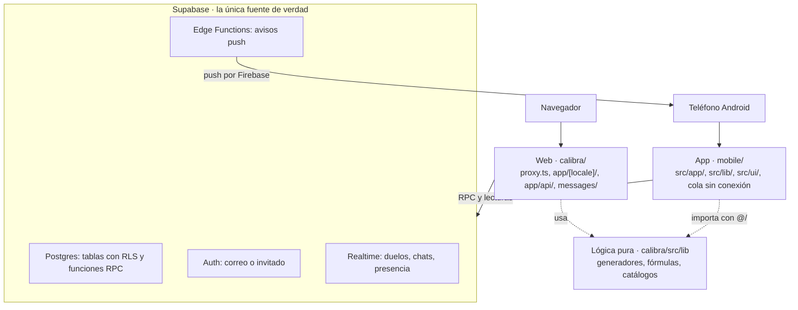

# Prodigia por dentro

Actualizada el 12 de octubre de 2026. Versión editable: https://claude.ai/code/artifact/3a3bb376-fa0d-45b5-a1a0-32b4b943ff2b

## Cómo leer esta guía

Prodigia son tres programas que comparten una sola base de datos: la web (Next.js, carpeta `calibra/`), la app de Android (Expo, carpeta `mobile/`) y Supabase (Postgres con sus funciones, en `calibra/supabase/`). Esta guía explica cómo encajan, sección por sección, y en cada una nombra los archivos exactos para que abras el código al lado.

Todo lo escrito acá se verificó contra el código del 12 de octubre de 2026 (commit `093ef67`). Varios `.md` viejos de `calibra/docs/` quedaron desactualizados (por ejemplo, `README.md` todavía dice Next 15 y `ARCHITECTURE.md` habla de 128 migraciones cuando hay 277): ante una contradicción, manda el código.

### Ruta de aprendizaje recomendada

Léela en este orden; cada paso se apoya en el anterior.

1. **El vocabulario.** `calibra/src/types/database.ts`: los tipos de las tablas, los rangos de ELO y los nombres que aparecen en todo el resto.
2. **Los mundos.** `calibra/src/lib/mundos.ts` (la lista de los 15) y un generador simple, como `calibra/src/lib/practica/problems.ts` (aritmética).
3. **Las fórmulas del juego.** `calibra/src/lib/practica/formulas.ts` (Exp por respuesta), `skillLevels.ts` (cómo sube y baja tu nivel) y `worldLevel.ts` (nivel de cada mundo).
4. **Una partida completa en la web.** La ruta `calibra/src/app/api/attempts/route.ts` (cada respuesta) y `calibra/src/app/api/practica/finish/route.ts` (el cierre). La sección «El viaje de una partida» la recorre paso a paso.
5. **La base de datos.** Las migraciones que crean `insertar_intento` y `registrar_xp_diario`, en `calibra/supabase/migrations/`. Ahí está la verdad de la Exp, las Chispas y la racha.
6. **La app.** `mobile/README.md`, después `mobile/src/app/_layout.tsx`, `mobile/src/lib/jugador.ts` y `mobile/src/lib/partida.ts`: verás que llama a las mismas funciones de la base que la web.
7. **Lo demás por tema:** competir, economía y social, con sus secciones de esta guía.

### Tres reglas que explican casi todo

- **La base decide.** Ni la web ni la app calculan Exp, ELO, precios o premios por su cuenta: llaman a funciones de Postgres (RPC) que validan y guardan. El cliente solo muestra.
- **La lógica pura se escribe una vez.** Los generadores de preguntas, el catálogo de la tienda o las insignias viven en `calibra/src/lib/` y la app los importa con `@/`. Las pantallas sí se hacen dos veces, una por plataforma.
- **Paridad web ↔ app.** Lo que el jugador ve existe en las dos, o el trabajo está incompleto. `npm run paridad` (en `mobile/`) lo controla para mundos y visuales de lecciones.

## Mapa general

El repo `calibra-proyecto` tiene dos proyectos de código y una base compartida: la web en `calibra/`, la app en `mobile/` y el esquema de Supabase dentro de `calibra/supabase/`. La web y la app hablan con la misma base; la app además importa la lógica pura de la web.

| Carpeta | Qué es | Lo que tienes que saber |
| --- | --- | --- |
| `calibra/src/app/[locale]/` | Las páginas de la web, una carpeta por ruta | `[locale]` es `es` o `en`: toda URL empieza con el idioma |
| `calibra/src/app/api/` | 51 rutas de servidor (`route.ts`) | Validan la sesión y llaman a funciones de la base; la app no las usa salvo excepciones |
| `calibra/src/lib/` | Lógica pura y acceso a datos por tema | Generadores de preguntas (`practica/`), catálogos (`recompensas/`, `tienda/`), mundos, logros, títulos |
| `calibra/src/components/` | Componentes de la web | Botones, duelos, landing, tienda, recompensas |
| `calibra/src/types/database.ts` | Tipos de las tablas y constantes centrales | Rangos de ELO (`RANGOS_ELO`), tipos de pregunta |
| `calibra/messages/` | Textos de la web en `es.json` y `en.json` | next-intl: un texto nuevo va en los dos |
| `calibra/supabase/migrations/` | 277 archivos SQL numerados (0001 a 0277) | El único lugar donde existe el esquema; se aplican a mano |
| `calibra/supabase/functions/` | 5 funciones de servidor (Edge Functions) | Mandan avisos push: duelos, mensajes, clan, anuncios y racha en riesgo |
| `calibra/docs/` | Documentación interna, planes y auditorías | Mucho es histórico; ver la nota de la sección anterior |
| `calibra/android/` | La app vieja de Capacitor | Un contenedor que abría la web; la reemplazó la app de `mobile/` |
| `mobile/src/app/` | Las pantallas de la app (Expo Router) | Un archivo = una pantalla; `(tabs)/` son las 5 pestañas |
| `mobile/src/lib/` | Datos y lógica de la app | Llama directo a las funciones de la base, como la web |
| `mobile/src/ui/` | Componentes visuales de la app | Placa, sprint, ciudades, visuales de lecciones |
| `mobile/modules/widgets-prodigia/` | Widgets nativos de Android (Kotlin) | Se dibujan sin arrancar JavaScript |
| `mobile/scripts/` | Utilidades | `paridad.mjs` (chequeo web ↔ app) y generadores de sonidos |

### Cómo se conectan

- **Navegador → web.** Cada pedido pasa por `calibra/src/proxy.ts` (el middleware): pone el idioma en la URL, refresca la sesión de Supabase y bloquea a los invitados las rutas que no les tocan.
- **Web → base.** Las páginas de servidor leen con `calibra/src/lib/supabase/server.ts`; los componentes de cliente usan `client.ts`. Las acciones que cambian algo importante pasan por una ruta de `api/` que llama a una RPC.
- **App → base.** La app usa su propio cliente (`mobile/src/lib/supabase.ts`) y llama a las mismas RPC directamente, sin pasar por la web. Para lo que todavía no tiene, abre la web publicada (`ORIGEN_WEB` en `mobile/src/lib/entorno.ts`).
- **App → código de la web.** El alias `@/` de la app apunta a `calibra/src` (lo configuran `mobile/tsconfig.json` y `mobile/metro.config.js`). Así la app usa los mismos generadores, catálogos y fórmulas sin copiarlos.
- **Base → teléfonos.** Las Edge Functions mandan los avisos push; las salas de duelo, el chat y la presencia usan los canales en vivo de Supabase (Realtime).



Las flechas de abajo son llamadas a la base; la caja punteada es código que la app toma de la web sin copiarlo.

## Stack y cómo correr todo

La web es Next.js 16 con React 19 y la app es Expo SDK 57 con React Native 0.86; las dos usan TypeScript y el mismo proyecto de Supabase.

| Pieza | Versión | Para qué se usa |
| --- | --- | --- |
| Next.js (App Router) | 16.3 | Páginas y rutas de servidor de la web. Ojo: cambia APIs entre versiones; la guía real está en `calibra/node_modules/next/dist/docs/` |
| next-intl | 4 | Idiomas `es` y `en`; textos en `calibra/messages/` |
| Tailwind CSS | 4 | Estilos de la web, más `calibra/src/app/globals.css` |
| Framer Motion, GSAP, Three.js | 13, 3, 0.185 | Animaciones y escenas 3D de la web |
| KaTeX | 0.18 | Fórmulas matemáticas |
| Supabase (Postgres, Auth, Realtime, Storage) | supabase-js 2 | Base de datos, cuentas, canales en vivo e imágenes subidas |
| Paddle | paddle-js 1.6 | Cobros en la web (Pro y Chispas) |
| Expo + Expo Router | 57 | La app y su navegación por archivos |
| Reanimated, Skia | 4.5, 2.6 | Animaciones y dibujo en la app |
| AdMob (react-native-google-mobile-ads) | 17.2 | Anuncios en la app; hoy con los IDs de prueba de Google |
| Vitest | 4 | 133 archivos de tests en la web |

### Variables de entorno

La web lee `calibra/.env.local` y la app `mobile/.env.local`; ninguna se sube al repo.

| Variable | Dónde | Qué es |
| --- | --- | --- |
| `NEXT_PUBLIC_SUPABASE_URL`, `NEXT_PUBLIC_SUPABASE_ANON_KEY` | Web | Dirección y clave pública de Supabase |
| `SUPABASE_SERVICE_ROLE_KEY` | Web, solo servidor | Clave con todos los permisos; la usa `calibra/src/lib/supabase/admin.ts` (pagos con Paddle y borrar la cuenta) |
| `NEXT_PUBLIC_SITE_URL` | Web | La dirección pública del sitio |
| `PADDLE_*`, `NEXT_PUBLIC_PADDLE_CLIENT_TOKEN` | Web | Claves y precios de Paddle |
| `NEXT_PUBLIC_ADSENSE_CLIENT` | Web | Cuenta de AdSense |
| `EXPO_PUBLIC_SUPABASE_URL`, `EXPO_PUBLIC_SUPABASE_ANON_KEY` | App | Los mismos valores que la web; para el APK de la nube van en `mobile/eas.json` |
| `EXPO_PUBLIC_ADMOB_*` | App | IDs reales de los bloques de anuncios (sin ellos usa los de prueba) |

### Comandos

| Qué | Dónde | Comando |
| --- | --- | --- |
| Web en local | `calibra/` | `npm run dev` y abrir http://localhost:3000 |
| Tests de la web | `calibra/` | `npm test` |
| Tipos y lint de la web | `calibra/` | `npx tsc --noEmit` y `npm run lint` |
| App con Expo Go | `mobile/` | `npx expo start` y escanear el QR (sin widgets ni módulos nativos nuevos) |
| Tipos, lint y paridad de la app | `mobile/` | `npx tsc --noEmit`, `npx eslint src`, `npm run paridad` |
| APK local | cualquier lado | `powershell -NoProfile -ExecutionPolicy Bypass -File D:\android-build\compilar.ps1 *> D:\android-build\compilarN.log`; deja `D:\Prodigia-APK\Prodigia.apk` |
| APK en la nube (EAS) | `mobile/` | `npx eas-cli@latest build -p android --profile preview` |

Un detalle curioso: los tests de las lecciones también escriben SQL. Por ejemplo, `QUIMIA_ESCRIBIR_SQL=1 npx vitest run src/lib/quimia/lecciones` regenera la migración con el contenido de las lecciones de Quimia; sin la variable, el test solo comprueba que la migración coincide con el código.

## La base de datos

Toda la verdad del juego vive en Postgres (Supabase): unas 74 tablas vigentes (76 creadas, 2 borradas después) y cerca de 290 funciones, creadas por 277 migraciones numeradas en `calibra/supabase/migrations/`. No hay otro lugar donde esté el esquema.

### Cómo leer las migraciones

- **Se aplican a mano y en orden.** El dueño las pega en el SQL Editor de Supabase. Una migración nueva toma el número siguiente a la última del repo (`ls calibra/supabase/migrations | tail -1`).
- **Vale la última versión de cada función.** Las funciones se redefinen muchas veces con `create or replace`. Por ejemplo, `insertar_intento` aparece en 5 migraciones y la vigente es la de `0259_constelaciones_y_alineacion.sql`; `registrar_xp_diario` aparece en 9 y la vigente es `0156_nivel_cuenta_subio_expuesto.sql`. Para encontrarla: `grep -l "function public.NOMBRE" calibra/supabase/migrations/*.sql | tail -1`.
- **El código no puede depender de una migración sin aplicar.** Por eso varias llamadas de la web y la app toleran que una función todavía no exista.
- **Pendiente de confirmar:** según lo anotado el 10 de octubre, faltaban aplicar en producción las migraciones 0244 a 0277 (doble experiencia, recompensas, sincronización sin conexión, entre otras). Hay que revisarlo en Supabase.

### Las tablas, por tema

| Tema | Tablas principales |
| --- | --- |
| Jugador | `profiles` (nombre, Chispas, nivel de cuenta, plan, mundos, cosméticos, ELO), `subscriptions` |
| Partidas | `attempts` (cada respuesta), `skill_levels` (nivel 1 a 10 por tipo de pregunta), `daily_progress` (Exp por día y meta), `world_progress` (nivel de cada mundo) |
| Enigmia y lecciones | `logic_puzzles`, `logic_attempts`, `logic_skill_levels`, `techniques`, `technique_progress`, `logic_techniques`, `logic_technique_progress` |
| Competir | `duels`, `duel_results`, `duel_queue`, `duel_invites`, `retos_diarios_completados`, `retos_semanales_completados` |
| Logros y títulos | `achievements`, `user_achievements`, `titulos_usuario` |
| Economía | `tienda_compras`, `catalogo_cosmeticos`, `paquetes_tienda`, `chispas_purchases`, `payment_events`, `fondos_galeria`, `fondos_galeria_desbloqueados` |
| Recompensas | `capsulas_usuario`, `calendario_usuario`, `misiones_reclamadas`, `constelaciones_usuario`, `constelaciones_completadas`, `estrellas_otorgadas`, `premios_anuncio`, `regalos_amigos` |
| Social | `friendships`, `mensajes_directos`, `feed_posts`, `feed_reactions`, `problemas_personalizados`, `bloqueos_usuario`, `reportes_usuario` |
| Clanes | `clanes`, `clan_membresias`, `clan_mensajes`, `clan_misiones`, `clan_mision_reclamos`, `clan_invitaciones`, `clan_semanas_procesadas` |
| Avisos | `device_push_tokens`, `push_throttle`, `anuncios`, `anuncios_leidos` |
| Docentes | `groups`, `group_members`, `leads_colegios` |
| Trastienda | `trastienda_*` (casino, ruleta, apuestas, pizarra y más; solo en la web) |
| App sin conexión | `intentos_sincronizados` (para no contar dos veces lo que se sube después) |

### Seguridad: RLS y funciones `security definer`

Cada tabla tiene Row Level Security: con la clave pública, un jugador solo lee y escribe sus propias filas (`auth.uid()`). Lo que mueve valor (Exp, Chispas, ELO, compras, premios) está cerrado a la escritura directa y pasa por funciones `security definer`: corren con permisos del dueño de la base, validan quién llama y hacen el cambio completo. Por ejemplo, la política de `attempts` no deja insertar desde el cliente; solo se entra por `insertar_intento`.

Regla de la casa: una función con salida en tabla (`returns table`) que cambia el nombre de una columna de salida necesita `drop function` antes, porque `create or replace` lo rechaza.

### Tres nombres que confunden

- **`puntos_total` son las Chispas.** Es el saldo que se gasta en la tienda.
- **La Exp no se guarda en un solo lugar.** Cada respuesta guarda su Exp en `attempts.xp`; el día la suma en `daily_progress.xp_ganado`, y el total histórico va a `profiles.xp_historico_total`, que define el nivel de cuenta.
- **`profiles.streak_dias` no se usa.** Nada lo escribe: la racha se calcula desde `daily_progress` (días seguidos con la meta cumplida o congelados). La app lo leía por error y mostraba siempre 0; se corrigió el 12 de octubre (commit `868b055`).

## Cuentas, sesión y la Placa

Las cuentas son de Supabase Auth, y cada usuario tiene una fila en `profiles` que crea un trigger (`handle_new_user`, desde `0001_init.sql`) en el momento del alta. Hay dos tipos de cuenta: con correo y contraseña, o invitado.

### Entrar

- **Con correo o con nombre de usuario.** `calibra/src/app/[locale]/login/LoginForm.tsx`: si lo escrito no tiene `@`, primero pregunta el correo real con la RPC `resolver_email_por_usuario` y después llama a `signInWithPassword`. Ante un error, el mensaje es el mismo para «no existe» y «contraseña mal», a propósito.
- **Registro.** `calibra/src/app/[locale]/registro/RegistroForm.tsx` llama a `signUp`; si Supabase pide confirmar el correo, la sesión llega recién al confirmar.
- **Invitado.** `signInAnonymously` crea un usuario real sin correo. Juega de verdad (sus intentos se guardan con su id), pero no entra a Aprender, Perfil, Pro, Rankeds, Social, Grupos ni Clanes: la lista única está en `calibra/src/lib/auth/rutasInvitado.ts`, y la leen tanto el middleware (`proxy.ts`) como cada página (`guard.ts`). Tampoco puede comprar con dinero.
- **De invitado a cuenta.** `calibra/src/components/ConvertirCuenta.tsx` le agrega correo y contraseña al mismo usuario con `updateUser`; por eso no se pierde nada de lo jugado.

### Los primeros pasos

La primera vez, el jugador elige 2 mundos gratis. Lo hace la RPC `elegir_mundos_iniciales` (versión vigente en `0263_mundos_dinamia_vitalia.sql`), que se puede llamar una sola vez. En la web hay dos caminos (la página `onboarding` para cuentas ya creadas y `components/landing/FlujoElegirMundos` para invitados); en la app, `bienvenida.tsx` y `elegir-mundos.tsx`. Después, cada mundo pide un diagnóstico inicial de 8 preguntas (12 en Numeria) para arrancar en el nivel justo (`mobile/src/lib/diagnostico.ts`).

### Guardias de cada página (web)

`calibra/src/lib/auth/guard.ts` tiene una función por situación: `requireUsuario` (hay sesión) y `requireMundoQuimia`, `requireMundoHistoria`, etc. (el mundo está desbloqueado o el plan es Pro). El parámetro `enDuelo` deja jugar un mundo no comprado cuando es parte de un duelo.

### La sesión en la app

`mobile/src/lib/sesion.tsx` guarda la sesión y la expone con `useSesion()`. Sobre ella, `mobile/src/lib/jugador.ts` mantiene el estado que se ve en todas las pantallas (Placa, Chispas, racha, avisos, plan, mundos) con `useJugador()`, y guarda una copia en el teléfono para arrancar sin red. `recargarJugador()` lo refresca y `fijarChispas()` actualiza el saldo al instante después de una compra.

### La Placa

La Placa es la tarjeta de identidad del jugador: avatar con marco, nombre con fuente, animación y color, fondo, título, rango, nivel y clan. Sus datos son columnas de `profiles` (`marco_perfil`, `fuente_nombre`, `animacion_nombre`, `color_nombre`, `fondo_perfil`, `fondo_perfil_url`, `titulo_activo`, `elo_rating`, `nivel_cuenta`). En la app la dibuja `mobile/src/ui/placa/` en cuatro tamaños (`PlacaCompleta`, `PlacaTarjeta`, `PlacaFila`, `PlacaMini`), y `mobile/src/lib/placa.ts` arma sus datos. Las imágenes propias (avatar y fondo) se suben a los buckets `avatares` y `fondos-perfil` de Supabase Storage.

## Los mundos y las preguntas

Prodigia tiene 15 mundos y casi todas sus preguntas se generan con código en el momento, no se guardan en la base. La excepción es Enigmia, que usa un banco de acertijos guardado en la tabla `logic_puzzles`.

### Los 15 mundos

La lista con nombre y color está en `calibra/src/lib/mundos.ts`; precios y quién tiene qué mundo, en `calibra/src/lib/mundos/precios.ts`; en la app, los colores neón y los glifos van en `mobile/src/tema.ts`.

Numeria (aritmética, fracciones, decimales, potencias, álgebra y geometría) · Enigmia (lógica) · Geografía (por continente) · Quimia (química) · Anatomía · Melodía (música) · Trigonometría · Historia · Calculia (cálculo) · Circuitia (circuitos) · Estadística · Naipia (sistemas de conteo de cartas) · Codia (programación) · Dinamia (física) · Vitalia (biología).

### Tipos de pregunta (`problem_type`)

Cada mundo se divide en temas, y cada tema es un `problem_type`: `suma`, `fracciones_sumar`, `quimia_formulas`, `historia_fechas`, `dinamia_newton`… Es la unidad de todo: cada respuesta se guarda con su `problem_type`, el nivel se calibra por `problem_type` y el mundo se deduce de él. La lista completa de temas por mundo está en `SUBTIPOS` (`calibra/src/lib/practica/worldLevel.ts`).

Ojo: esa lista está repetida a mano en varios lugares (`api/attempts/route.ts`, `api/practica/finish/route.ts`, `worldLevel.ts`, `skillLevels.ts` y la función `mundo_de_problem_type` de la base). Un tema nuevo tiene que sumarse en todos.

### Los generadores

Viven en `calibra/src/lib/practica/` (uno o varios archivos por mundo) y en las carpetas de cada mundo (`calibra/src/lib/quimia/`, `historia/`…). Son funciones puras: reciben el tema y el nivel (1 a 10) y devuelven una pregunta. Ejemplo más simple: `generarProblema("suma", nivel)` en `practica/problems.ts`.

Aceptan un `rng` opcional, un generador de números al azar con semilla (`mulberry32` en `calibra/src/lib/rng.ts`). En un duelo, los dos rivales usan la misma semilla y reciben exactamente las mismas preguntas.

### La forma común: `MundoJugable`

Cada mundo devuelve sus preguntas con forma propia, así que hay un adaptador por mundo en `calibra/src/lib/mundosJugables/` que las traduce a una sola forma, `PreguntaMundo` (`tipos.ts`):

- `enunciado` y su `formato` (LaTeX o subíndices químicos).
- `entrada`: opciones, un número con tolerancia, o tocar un hueso en el esqueleto.
- `visuales`: lo que se dibuja arriba (pentagrama, molécula, triángulo, circuito, gráfico, código, cartas…).
- `memoria`: una fase de memorizar con el reloj en pausa (Enigmia y Naipia).

Gracias a eso, el sprint genérico de la app, los duelos y el Modo Zen (web y app) usan una sola conversión. Numeria y Geografía tienen pantallas propias en la app (`mobile/src/app/numeria/`, `geografia/`); los otros 13 usan `mobile/src/app/[mundo]/`.

### Tres niveles distintos

| Nivel | Rango | Qué lo mueve | Dónde |
| --- | --- | --- | --- |
| Nivel de tema (calibración) | 1 a 10 | Sube con 3 aciertos seguidos, baja 1 con un error (no baja si hay escudo) | `skill_levels`; lógica en `practica/skillLevels.ts` y en `insertar_intento` |
| Nivel de mundo | 1 a 100 | 34 % la Exp ganada en el mundo (tope 25.000), 45 % el dominio de sus temas (niveles 4 a 10), 21 % las lecciones completadas | `world_progress`; fórmula en `practica/worldLevel.ts` y `registrar_progreso_mundo` |
| Nivel de cuenta | 1 en adelante | La Exp histórica total; cada nivel nuevo regala Chispas | `profiles.nivel_cuenta`; `acreditar_chispas` y `nivel_desde_xp_cuenta` |

### Lecciones (Aprender)

Cada mundo tiene Técnicas (gratis) y Clases (Pro, la primera gratis). El contenido está escrito en TypeScript en `calibra/src/lib/<mundo>/lecciones/` (`tecnicas-*.ts`, `clases-*.ts`) y tiene animaciones propias: 118 visuales, hechos una vez para la web y otra para la app (`mobile/src/ui/visuales/`). La web guarda el progreso con la ruta `api/aprender/completar` y la app con la RPC `completar_leccion`, en `technique_progress`. Los tests de cada carpeta de lecciones generan el SQL que sube ese contenido a la base (ver Stack).

## El viaje de una partida

Una partida (sprint) son 10 preguntas o 60 segundos, lo que llegue primero, con 2 escudos. Cada respuesta se guarda al instante y, al terminar, una segunda llamada cierra el día. Nada de la Exp se decide en el teléfono ni en el navegador.

### Paso a paso

1. **Elegir y preparar.** El jugador toca Jugar en un tema. La pantalla lee su nivel de ese tema en `skill_levels` y genera la primera pregunta con el generador del mundo (en el navegador o en el teléfono).
2. **Responder.** Se mide el tiempo de respuesta en milisegundos. Si es correcta y el nivel es 5 o más, el reloj gana de 1 a 3 segundos (tope 20 s; `practica/useBonusTiempo.ts`). Las ayudas compradas (hielo: reloj quieto 10 s; +3 s) no se usan en duelos.
3. **Guardar la respuesta.** La web manda `POST /api/attempts`; la app llama directo a la RPC `insertar_intento` (`mobile/src/lib/partida.ts`). Los dos terminan en la misma función de la base.
4. **La base calcula la Exp** (`insertar_intento`, versión de la migración 0259):
   1. Tiempo esperado del nivel: 6.000 ms en el nivel 1, 350 ms menos por nivel (2.850 ms en el 10).
   2. Anti-apuro: si respondiste en menos del 12 % de ese tiempo (mínimo 150 ms), la respuesta es «sospechosa» y vale 0.
   3. Exp = 10 × multiplicador de nivel (1 + 0,15 por nivel sobre el 1) × bonus de velocidad (de 1 a 1,5 según qué tan rápido), redondeado. Un error vale 0, nunca resta.
   4. Si hay un potenciador comprado en la tienda, se multiplica.
   5. Si ese mundo es el de «Doble Exp» del día, o es la Gran Alineación, se duplica.
   6. Guarda la fila en `attempts` y recalibra el nivel del tema en `skill_levels`: 3 aciertos seguidos suben 1, un error baja 1 (salvo que el escudo esté activo).
5. **Cerrar la partida.** La web manda `POST /api/practica/finish`; la app hace lo mismo desde `cerrarPartida` en `partida.ts`. Pasan cuatro cosas:
   1. `registrar_xp_diario` suma la Exp del día. Ignora el número que le manda el cliente: recalcula desde `attempts` y `logic_attempts` lo ganado hoy y acredita solo la diferencia, así que llamarla dos veces no suma dos veces.
   2. Dentro, `acreditar_chispas` convierte esa Exp en Chispas (1 a 1), suma la Exp histórica, sube el nivel de cuenta si corresponde (con regalo de Chispas) y suma la Exp al clan.
   3. `registrar_progreso_mundo` actualiza el nivel del mundo. Si cruza un múltiplo de 5, se publica un hito en el feed.
   4. Se revisan logros (`calibra/src/lib/logros/verificar.ts`), títulos (`titulos/verificar.ts`), recompensas (`revisar_recompensas`) y apuestas de la Trastienda.
6. **Resultado.** La pantalla de resultado muestra Exp ganada, Chispas, meta diaria, racha, nivel de mundo y de cuenta, y los logros nuevos. En la web lo arma `practica/SprintSummary.tsx`; en la app, `mobile/src/app/resultado.tsx`.

### Sin conexión (solo app)

Los generadores viven en el teléfono, así que sin internet se juega igual. Cada respuesta que no llega a la base se guarda en el teléfono con un id propio (`mobile/src/lib/sinConexion.ts`) y se sube al volver la red con `insertar_intento_sincronizado` (migración 0245), que no la duplica aunque se reintente. La tabla `intentos_sincronizados` recuerda qué ids ya entraron. La Exp de lo jugado sin red cuenta para el día en que se sube.

### En un duelo

Es la misma partida con dos diferencias: las preguntas salen de la semilla del duelo (los dos rivales ven las mismas) y, si el duelo es casual en un mundo que no compraste, la Exp no suma nivel de ese mundo. El cierre lo comprueba contra la fila real de `duels`, nunca contra lo que diga el cliente.

## Competir

Un duelo es una partida normal jugada por dos personas con las mismas preguntas. Solo los duelos de Rankeds mueven el ELO; los casuales y los retos entre amigos no.

### Tipos de duelo

| Tipo | Cómo se arma | ¿Mueve ELO? |
| --- | --- | --- |
| Ranked | Matchmaking: `buscar_rival_duelo` con `p_ranked = true`, busca a alguien de tu nivel en la cola (`duel_queue`) | Sí |
| Casual | La misma función con `p_ranked = false`: cualquiera que esté buscando casual en esa ciudad, al azar | No |
| Reto a un amigo | Desde Social, el feed o un enlace de invitación (`duel_invites`) | No |

La columna que decide es `duels.clasificatorio`. Desde la migración 0244 su valor por defecto es `false` y un trigger fuerza `false` en todo duelo creado directo por un cliente: solo el matchmaking puede crear un ranked. Así nadie puede retar a un amigo «en ranked» para inflarse el ELO.

### Cómo se juega

- **Asincrónico, con fantasma.** Cada uno juega su lado cuando puede. Si tu rival ya jugó, ves su «fantasma»: su secuencia de aciertos y tiempos (migraciones 0028 y 0058). Si no hay rival humano, el matchmaking pone un bot.
- **Sala en vivo.** Cuando los dos están conectados, la sala se sincroniza por canales de Supabase Realtime: `duelo:<id>:sala` (los dos listos) y `duelo:<id>:vivo` (el progreso de cada uno). En la app: `mobile/src/lib/duelos.ts`.
- **Mismas preguntas.** Se generan con la semilla del duelo (`rng` en los generadores).
- **Resultado.** `registrar_resultado_duelo` guarda tu puntaje y, cuando están los dos, aplica el ELO. Las rutas de la web: `api/duelos/resultado`, `rendirse`, `reclamar-abandono` y `finalizar-serie`.
- **Series.** Desde Platino (ELO 1300) las Rankeds son al mejor de 3 en ciudades al azar (`finalizar_serie_si_corresponde`, migraciones 0045, 0073, 0074 y 0094).
- **Desbloqueo.** Rankeds se abre en el nivel de cuenta 5 (`NIVEL_MINIMO_RANKEDS` en `mobile/src/lib/competir.ts`).

### El ELO

Es la fórmula clásica: tu resultado esperado depende de la diferencia de ELO, y ganas o pierdes según cuánto te alejaste de lo esperado.

```latex
E = \frac{1}{1 + 10^{(ELO_{rival} - ELO_{tuyo})/400}} \qquad ELO_{nuevo} = ELO + K \cdot (resultado - E)
```

El resultado es 1 si ganas, 0 si pierdes. K cambia según tu propio rango (`k_factor_de_elo`, migración 0072): 20 en Bronce, 17,5 en Plata, 15 en Oro, 12,5 en Platino y 10 en Diamante y Prodigio. Abajo los cambios pegan fuerte; arriba el rating es más estable.

### Rangos

Los 6 rangos están en `RANGOS_ELO` (`calibra/src/types/database.ts`): Bronce desde 0, Plata desde 900, Oro desde 1100, Platino desde 1300, Diamante desde 1500 y Prodigio desde 1700. Cada uno (menos Prodigio) se parte en tres divisiones iguales, III, II y I. La insignia es la de Torres: la geometría está en `calibra/src/lib/rangos/insigniaTorres.ts` y la dibujan `calibra/src/components/InsigniaRango.tsx` (web) y `mobile/src/ui/placa/InsigniaRango.tsx` (app).

### Liga y retos

- **Liga semanal.** Un ranking de la Exp de la semana (lunes a domingo, en UTC), general o de una ciudad, de todos o solo de tus amigos (`ranking_semanal_filtrado`; la liga existe desde la migración 0006).
- **Reto diario.** 5 preguntas de ciudades que tienes, generadas con la fecha como semilla: quien tiene las mismas ciudades recibe las mismas preguntas (`generarRetoDiario` en `calibra/src/lib/retoDiario.ts`); se cierra con `completar_reto_diario`.
- **Reto semanal.** 45 preguntas con el mismo criterio y su propio ranking (`completar_reto_semanal`).

## Economía

La moneda del juego son las Chispas (`profiles.puntos_total`), y hoy se ganan sobre todo jugando: cada punto de Exp da una Chispa. Los cobros con dinero real están escritos pero apagados (`PAGOS_REALES_HABILITADOS = false` en `calibra/src/lib/pagos/flags.ts`).

El documento que manda es `calibra/docs/economy/PLAN_ECONOMIA.md`: su primera tabla mide la economía real desde el código. Lo que sigue resume dónde vive cada pieza.

### De dónde salen las Chispas

| Fuente | Cuánto | Dónde |
| --- | --- | --- |
| Jugar | 1 Chispa por punto de Exp: de 10 a 35 por acierto | `insertar_intento` → `acreditar_chispas` |
| Subir de nivel de cuenta | 50 × nivel + 250 | `recompensa_nivel_cuenta` (0118) |
| Cápsulas, misiones, calendario, constelaciones | Ver Recompensas, abajo | 0249 y 0259 |
| Kit del Pionero y Primeros pasos | 1000 y unas 1150 | 0258 y 0260 |
| Pro | 10.000 al mes | `calibra/src/lib/pro/beneficios.ts` |

### En qué se gastan

- **Mundos.** Cada mundo nuevo cuesta 3000 Chispas (`PRECIO_MUNDO_CHISPAS` en `calibra/src/lib/mundos/precios.ts`); la base lo cobra en `desbloquear_mundo`. Los 2 primeros son gratis y Pro los abre todos mientras dure.
- **Tienda (Bazar).** Marcos, fondos, fuentes, animaciones y colores del nombre, estelas de la racha, efectos y sonidos de acierto, emotes de duelo, títulos, ciudad de la Placa, paquetes y ayudas para la partida (hielo, +3 s, pista, segunda oportunidad). El catálogo compartido está en `calibra/src/lib/recompensas/catalogo.ts` (`CATALOGO_NUEVO`, `PAQUETES`, `UTILIDADES_NUEVAS`) y la app lo junta con lo viejo en `mobile/src/lib/tienda.ts`. La compra la valida `comprar_item_tienda` (precio del catálogo de la base, nunca del cliente). Cada día un artículo está en oferta (`calibra/src/lib/descuentoDiario.ts`). Los temas visuales de la app están en `recompensas/temas.ts`, todavía como «Próximamente».
- **Trastienda.** Minijuegos de azar de la web (casino, ruleta, apuestas, pizarra) con su propia moneda, `monedas_trastienda`. No está en la app por la política de Google Play con menores.

### Recompensas

Todas las da la base; el cliente solo pregunta qué hay para reclamar (`revisar_recompensas`, que corre al cerrar cada partida).

- **Cápsulas.** Diaria, de nivel, de ciudad y de misiones. El premio lo sortea la base (`contenido_capsula`, 0249) y se muestran las probabilidades («¿Qué puede salir?»).
- **Misiones del día.** 3 por día, de 40, 50 y 60 Chispas.
- **Calendario de 7 días.** Un premio por día seguido de juego.
- **Constelaciones.** Estrellas que se ganan por ciudad; completar una da 300 Chispas. Cada tanto llega la Gran Alineación: unas horas con Exp doble para todos (`en_gran_alineacion`, 0259; contador en `recompensas/contadorAlineacion.ts`).
- **Doble Exp del día.** Cada día un mundo da Exp doble (`mundo_doble_experiencia` en la base, `calibra/src/lib/eventos/dobleExperiencia.ts` en el cliente).
- **Regalos entre amigos** (`regalos_amigos`).

### Pro

Pro cuesta US$4,99 al mes o US$39,99 al año (`calibra/src/lib/pagos/productos.ts`). Da todos los mundos, las Clases de Aprender, estadísticas, 10.000 Chispas al mes y ningún anuncio. El estado vive en `profiles.plan` y `subscriptions`. Desde la migración 0276, Pro se apaga solo al vencer y la web y la app muestran el aviso «Tu Pro terminó».

### Cobros

La web cobra con Paddle: `api/pagos/checkout` abre el pago y `api/webhooks/paddle` recibe la confirmación firmada (`PADDLE_WEBHOOK_SECRET`) y acredita con la clave de servicio. Hay un adaptador para Mercado Pago sin conectar. La app todavía no cobra: llegará con Google Play Billing.

### Anuncios

Solo para cuentas gratis (migración 0277). En la app, con AdMob (`mobile/src/lib/publicidad.ts`): uno entre partidas cada 3 de práctica, nunca en duelos, y dos anuncios opcionales con premio, una vez por día cada uno (repetir el premio del calendario o una cápsula extra). En la web, con AdSense (`calibra/src/lib/publicidad/web.ts`). El tope diario lo pone la base en `premio_por_anuncio()`. Hoy la app usa los IDs de prueba de Google; los reales van en `EXPO_PUBLIC_ADMOB_*`.

## Social

Lo social usa dos mecanismos de Supabase: tablas con RLS para lo que queda guardado (amistades, mensajes, posts) y canales de Realtime para lo que pasa en vivo (quién está conectado, chats abiertos, salas de duelo).

### Amigos y mensajes

- **Amistades.** Tabla `friendships`. En la web, las rutas `api/amigos/solicitar`, `responder`, `eliminar` y `retar`; en la app, las RPC directas desde `mobile/src/lib/social.ts` (`mis_amigos` y otras).
- **Mensajes directos.** Tabla `mensajes_directos`; se mandan con `enviar_mensaje_directo` y se leen con `mi_conversacion` y `mis_conversaciones` (que da los no leídos). Mientras el chat está abierto, llegan por el canal `dm:<a>:<b>`. Cada conversación puede tener su fondo (`fondos_chat_conversacion`; lógica en `calibra/src/lib/mensajes/fondosChat.ts`).
- **Presencia.** El canal `presencia:global` dice quién está en línea (`calibra/src/lib/presencia/`, `mobile/src/lib/social.ts`).
- **Cuidado de menores.** La app pregunta mes y año de nacimiento una vez (`mobile/src/lib/edad.ts`). Los menores de 13 solo chatean con frases rápidas y no ven texto libre de otros. Cualquiera puede bloquear (`bloqueos_usuario`) y reportar (`reportes_usuario`).

### Feed

El feed (`feed_posts`, `feed_reactions`) mezcla publicaciones automáticas (por ejemplo, los hitos de nivel de mundo cada 5 niveles) con desafíos que crea la gente: retar a un problema o subir un problema propio (`problemas_personalizados`). Rutas de la web: `api/feed/crear-desafio`, `crear-problema-personalizado`, `reaccionar`, `responder-personalizado` y `retar`.

### Clanes

- **Estructura.** `clanes` y `clan_membresias`, con dos roles: líder y miembro. Se crean, buscan, invitan (`clan_invitaciones`, 0140) y tienen imagen propia (0084).
- **Progreso.** Cada Exp que gana un miembro suma a su aporte y al total del clan (lo hace `acreditar_chispas`). El clan sube de nivel y su ciudad crece (`calibra/src/lib/clanes/tierCiudad.ts` elige una de 5 ilustraciones).
- **Misión del clan.** Juntar 3000 Exp entre todos y reclamar el premio (`mision_actual_de_clan`, `reclamar_mision_clan`; migraciones 0239 y 0240).
- **Guerra semanal y mapa.** Los clanes compiten por semana y se ven en un mapa con zoom (`mapa_clanes`, «Mundo de clanes», 0076). Hay clanes de bots para que siempre haya rivales (0066 y 0077).
- **Chat del clan.** `clan_mensajes`, en vivo por el canal `clan-chat:<id>`.

### Avisos push

Los mandan 5 Edge Functions de `calibra/supabase/functions/`, con Firebase Cloud Messaging, a los teléfonos guardados en `device_push_tokens`. Cuatro se disparan con un Database Webhook cuando se inserta una fila; la quinta corre una vez por día.

| Función | Se dispara con | Límite |
| --- | --- | --- |
| `notify-mensaje-directo` | Un mensaje nuevo en `mensajes_directos` | 1 cada 30 min por conversación |
| `notify-clan-mensaje` | Un mensaje nuevo en `clan_mensajes` | 1 cada 30 min por persona y clan |
| `notify-duelo` | Un duelo nuevo en `duels` | Inmediato |
| `notify-anuncio` | Un anuncio nuevo en `anuncios` | 2 por día, nunca de 21:00 a 08:00 |
| `racha-en-riesgo` | Programada, entre las 19:00 y las 20:00 | 2 por día |

Las reglas comunes (categorías, anti-spam en `push_throttle`, horario silencioso) están en `_shared/avisos.ts`. Cómo desplegarlas: `calibra/supabase/functions/README.md`. En la app, el centro de avisos es `mobile/src/app/avisos.tsx` y las preferencias por categoría, `ajustes-avisos.tsx`.

## La web por dentro

La web es una app de Next.js con el App Router: cada carpeta dentro de `calibra/src/app/` es una ruta, y cada `page.tsx` es una página. Todo lo visible cuelga de `[locale]`, así que las URLs son `/es/numeria`, `/en/tienda`, etc.

### La forma de una página típica

1. **`page.tsx` corre en el servidor.** Crea el cliente de Supabase de servidor (`lib/supabase/server.ts`, con las cookies de la sesión), comprueba el acceso con una guardia (`requireUsuario`, `requireMundoQuimia`…) y lee los datos iniciales.
2. **Le pasa los datos a un componente de cliente.** Suelen llamarse `XxxClient.tsx` (`PracticaClient`, `TiendaClient`, `RankedsClient`). Llevan `"use client"` arriba y tienen la interacción y las animaciones.
3. **El cliente cambia datos por dos caminos.** Lo importante pasa por una ruta de `api/` (`fetch("/api/...")`); lo simple y protegido por RLS, con el cliente de navegador (`lib/supabase/client.ts`) llamando a una RPC.

Ejemplo completo: `calibra/src/app/[locale]/practica/` tiene `page.tsx` (servidor), `PracticaClient.tsx` (elegir tema y nivel), `SprintRunner.tsx` (la partida) y `SprintSummary.tsx` (el resultado).

### Las rutas de API

Son 51 archivos `route.ts` en `calibra/src/app/api/`. Todas siguen el mismo patrón:

1. `createClient()` de servidor y `supabase.auth.getUser()`; sin usuario, responde 401.
2. Leen el cuerpo del pedido y validan lo básico.
3. Llaman a una o varias RPC.
4. Si algo falla, responden con `respuestaError(contexto, error)` (`calibra/src/lib/api/respuestaError.ts`). Solo los errores escritos a propósito en la base (código `P0001`, los `raise exception` en español) llegan tal cual al jugador; cualquier otro se cambia por un mensaje genérico y el detalle queda en el log del servidor.

### Lo que envuelve a todas las páginas

`calibra/src/app/layout.tsx` carga las fuentes, los textos del idioma (`NextIntlClientProvider`) y una serie de piezas que están siempre: aviso de conexión, avisos de duelo, anuncios (`AnunciosModal`), aviso de Pro vencido, publicidad, el sticker de descarga de la app, el service worker y los mensajes sin leer.

`calibra/src/proxy.ts` (el middleware; antes se llamaba `middleware.ts`) corre antes de cada página: pone el idioma en la URL, refresca la sesión y frena a los invitados en las rutas que no les tocan.

### Idiomas

- **Configuración.** `calibra/src/i18n/routing.ts`: idiomas `es` y `en`, español por defecto y siempre con prefijo en la URL.
- **Textos.** `calibra/messages/es.json` y `en.json`, agrupados por pantalla (`Recompensas.tienda`, `DescargarApp`…). En un componente: `const t = useTranslations("DescargarApp")` y después `t("titulo")`.
- **Enlaces.** Se importan de `@/i18n/navigation`, no de `next/link`, para que mantengan el idioma.
- **Regla de escritura.** Español neutro con «tú», nunca voseo (`calibra/docs/TERMINOLOGY.md`).

### Componentes

`calibra/src/components/` tiene 102 entradas. Las más usadas: `Boton.tsx` (el botón de la marca), `RangoBadge.tsx` e `InsigniaRango.tsx` (rangos), `duelos/`, `landing/` (la portada para visitantes), `recompensas/` y `reactbits/` (una biblioteca de efectos visuales).

## La app por dentro

La app es Expo con Expo Router: cada archivo de `mobile/src/app/` es una pantalla y las carpetas entre paréntesis agrupan sin cambiar la URL. Habla directo con Supabase y no depende de que la web esté andando. El mejor punto de partida es `mobile/README.md`, que tiene tablas de pantallas y de archivos de datos actualizadas.

### El arranque

`mobile/src/app/_layout.tsx` es lo primero que corre. En orden: carga las fuentes, muestra el video del mamut (`ui/IntroMarca`) y la pantalla de carga con progreso real (`ui/PantallaCarga`), lee la sesión (`ProveedorSesion`) y, con ella, el jugador guardado en el teléfono (`cargarJugadorGuardado`). Después arranca la sincronización de lo jugado sin red, la presencia en línea, los avisos push, los sonidos y la publicidad. También decide a dónde mandar a alguien sin sesión o sin mundos elegidos, y monta las piezas globales: avisos (`ui/Aviso`), invitaciones a duelo (`ui/AvisoDuelo`), términos, primera vez y festejos de constelaciones.

### Pantallas

- `(tabs)/`: las 5 pestañas (Hoy, Mundos, Competir, Social, Perfil). Se deslizan de lado y quedan montadas al cambiar de una a otra; la barra de abajo es `ui/BarraPestanas.tsx` y el encabezado con racha y Chispas, `ui/HUD.tsx`.
- `numeria/` y `geografia/`: mundos con pantallas propias.
- `[mundo]/`: el hub (`index.tsx`) y la partida (`sprint.tsx`) de los otros 13 mundos, armados con su `MundoJugable`.
- Pantallas apiladas: `duelo/`, `reto/`, `clan/`, `chat/`, `jugador/`, `amigos/`, `aprender/`, `diagnostico/`, `tienda`, `recompensas`, `resultado`, `ajustes`, `pro` y más.

### Datos (`mobile/src/lib/`)

Un archivo por tema, sin pantallas: `partida.ts` (guardar y cerrar partidas), `jugador.ts` (estado global), `competir.ts` y `duelos.ts`, `social.ts`, `clanes.ts`, `tienda.ts`, `recompensas.ts`, `sinConexion.ts`, `notificaciones.ts`, `publicidad.ts`. La tabla completa, con las RPC que usa cada uno, está en `mobile/README.md`.

### El código compartido con la web

El alias `@/` apunta a `calibra/src`. Lo resuelven `mobile/tsconfig.json` (para los tipos) y `mobile/metro.config.js` (para empaquetar), que también alcanza `calibra/public/data` y `calibra/messages`. Solo se importa lógica pura: nada de React DOM ni de Next. Un detalle: la web tipa el cliente de Supabase con su propia copia del paquete, así que al pasarle el de la app se castea (`supabase as unknown as ClienteWeb`, en `lib/partida.ts`).

### Diseño y componentes

- **Tokens.** `mobile/src/tema.ts`: colores, fuentes, los mundos con su color base, su neón y su glifo.
- **Piezas base.** `ui/Texto.tsx` para todo texto (variantes `h1`, `h3`, `nota`, `mono`…), `ui/Boton3D.tsx` para los botones, `ui/Tarjeta.tsx`, `ui/Hoja.tsx` (panel que sube desde abajo), `ui/Ciudad.tsx` y `ui/Cielo.tsx` (las ciudades nocturnas con aviones y ovnis).
- **Visuales de lecciones.** `ui/visuales/`, uno por cada visual de la web.

### Reglas de rendimiento

Las define `mobile/src/lib/rendimiento.ts`, después de que en un teléfono de 4 GB las animaciones fueran lentas:

1. **Lo que no se ve no se anima.** Toda animación en bucle se pausa con `useAnimacionActiva()` cuando su pantalla no tiene el foco o la app está en segundo plano.
2. **Menos efectos en teléfonos modestos.** Con menos de unos 6 GB de RAM, o si el jugador lo pide en Ajustes, `useLiviano()` reduce partículas y efectos.

### Widgets

`mobile/modules/widgets-prodigia/` es un módulo nativo en Kotlin. Android dibuja los widgets solo con los últimos datos que guardó la app (`lib/resumen.ts` los deja en el teléfono), sin arrancar JavaScript; con la librería anterior no se veían en teléfonos Xiaomi.

### Paridad con la web

Lo que el jugador ve existe en las dos plataformas. `npm run paridad` (`mobile/scripts/paridad.mjs`) compara mundos y visuales de lecciones y falla si algo está en un lado y no en el otro. Hoy: 15 mundos y 118 visuales en cada lado. Las excepciones permitidas (Trastienda, pagos con dinero, borrar la cuenta) están en `calibra/docs/PARIDAD_APP_WEB.md`.

## Calidad y herramientas

No hay integración continua: ningún servicio corre los chequeos solo en cada cambio (está anotado como pendiente REPO-05 en `calibra/docs/audits/REVISION-GENERAL-2026-09-26.md`). Los chequeos se corren a mano antes de dar algo por terminado.

| Chequeo | Comando | Qué atrapa |
| --- | --- | --- |
| Tipos de la web | `npx tsc --noEmit` en `calibra/` | Errores de TypeScript |
| Tipos de la app | `npx tsc --noEmit` en `mobile/` | Lo mismo, incluido el código de la web que la app importa |
| Lint | `npm run lint` (web), `npx eslint src` (app) | Imports sin usar, malas prácticas de React |
| Tests | `npm test` en `calibra/` | 133 archivos de Vitest, sobre todo de generadores, fórmulas y catálogos |
| Paridad | `npm run paridad` en `mobile/` | Un mundo o un visual de lección que existe en un lado y no en el otro |
| Build de la web | `npm run build` en `calibra/` | Errores que solo aparecen al compilar las rutas |
| Exportar la app | `npx expo export --platform android` en `mobile/` | Que el empaquetado de la app funcione sin compilar el APK |

### Qué prueban los tests

Casi todos están al lado del código que prueban (`calibra/src/lib/practica/quimia.test.ts` junto a `quimia.ts`). Comprueban que cada generador da preguntas válidas en todos los niveles, que no repite, que las fórmulas de Exp y nivel dan lo esperado, que los catálogos no tienen precios rotos y que el reto diario sale igual con la misma fecha. Los tests de lecciones además comprueban que la migración con el contenido coincide con el código (y la regeneran con la variable `*_ESCRIBIR_SQL=1`).

### Scripts útiles (`calibra/scripts/`)

- `crear-usuario-qa.mjs` y `login-qa.mjs`: cuentas de prueba, con datos en `calibra/.env.test.local`.
- `detectar-voseo.mjs` y `normalizar-espanol.mjs`: buscan y corrigen voseo en los textos.
- `verificar-claves-i18n.mjs`: que `es.json` y `en.json` tengan las mismas claves.
- `marketing-capturas-*.mjs`: capturas de pantalla para redes, con Playwright.
- `calibra/e2e-app.mjs` es una prueba de punta a punta con Playwright.

## Publicar

Hay tres cosas que se publican por separado: la web, la base y la app. Una función nueva suele necesitar las tres en este orden: primero la migración, después la web, después la app.

### La base

Cada migración nueva se pega y se corre a mano en el SQL Editor de Supabase, en orden de número. Las Edge Functions se despliegan con `supabase functions deploy <nombre>` y sus Database Webhooks se configuran en el panel (pasos en `calibra/supabase/functions/README.md`).

### La web

Producción está en Vercel, en `https://prodigia-sandy.vercel.app`. El código está en GitHub (`jjacobolalvarez34-rgb/Prodigia`, rama `main`). El repo no documenta cómo se dispara cada despliegue; lo normal en Vercel es que publique solo con cada cambio en `main`, y hay que confirmarlo en su panel. Si cambia el dominio, hay que actualizar en Supabase la Site URL y las Redirect URLs, o los correos de confirmación llevan a una dirección vieja (pasó dos veces, ver `calibra/docs/PROGRESO.md`).

### La app (APK)

1. **Subir la versión** en `mobile/app.json`: `version` (la que se ve, por ejemplo `0.2.0`) y `android.versionCode` (un entero que siempre crece; Android no instala encima un número menor).
2. **Compilar.** En esta máquina, con `D:\android-build\compilar.ps1` (unos 10 a 60 minutos): hace `expo prebuild --clean`, compila en release para `arm64-v8a` y deja `D:\Prodigia-APK\Prodigia.apk`. Otra opción es la nube de Expo (EAS). La carpeta `mobile/android/` se regenera cada vez: no se edita a mano, la configuración nativa va en `app.json`.
3. **Publicar en GitHub Releases** con el archivo llamado exactamente `Prodigia.apk`, sin marcar pre-release y marcado como «latest». La web descarga siempre desde `releases/latest/download/Prodigia.apk` (configurado en `calibra/src/lib/appAndroid.ts`, que pasa por la ruta `/api/app/descargar`).
4. **Actualizar la web**: el número de versión y los MB en `APP_ANDROID` (`appAndroid.ts`).

El APK se firma con la clave de depuración, así que se puede instalar encima de una versión anterior compilada igual. Para Google Play hace falta una firma propia y un AAB (perfil `production` de `mobile/eas.json`); el plan está en `calibra/docs/app-nativa/05-PUBLICACION-GOOGLE-PLAY.md` y la revisión previa, en `calibra/docs/REVISION_ANTES_DE_PLAY_STORE.md`.

## Glosario

| Término | Qué es | En el código |
| --- | --- | --- |
| Chispas | La moneda que se gasta en la tienda | `profiles.puntos_total` |
| Exp (experiencia) | Lo que da cada acierto; sube niveles y la meta diaria | `attempts.xp`, `daily_progress.xp_ganado`, `profiles.xp_historico_total` |
| Meta diaria | Exp que hay que juntar en el día para que cuente la racha | `profiles.meta_xp_diaria`, `daily_progress.meta_alcanzada` |
| Racha | Días seguidos con la meta cumplida (o congelados) | `calcularRachaDiaria` en `calibra/src/lib/practica/racha.ts` |
| Racha de aciertos (combo) | Aciertos seguidos dentro de una partida; enciende las llamas | `practica/useRachaCombo.ts` |
| Congelamiento (hielo) | Protege un día de racha; en partida, congela el reloj 10 s | `daily_progress.congelado`, `practica/congelamientos.ts` |
| Escudo | Una partida tiene 2: si fallas con escudo, tu nivel de tema no baja | parámetro `protegido` de `insertar_intento` |
| Sprint | Una partida: 10 preguntas o 60 segundos | `SprintRunner.tsx` (web), `ui/Sprint.tsx` (app) |
| Calibración | El nivel 1 a 10 de cada tema, que sube y baja solo | `skill_levels`, `practica/skillLevels.ts` |
| Tema (`problem_type`) | La unidad mínima de práctica: `suma`, `quimia_formulas`… | columna `problem_type` |
| Mundo o ciudad | Una materia con sus temas; se dibuja como una ciudad de noche | `MundoSlug`, `calibra/src/lib/mundos.ts` |
| Placa | La tarjeta de identidad del jugador | `ui/placa/` (app), columnas de `profiles` |
| Rango y división | Bronce a Prodigio, cada uno con III, II y I | `RANGOS_ELO`, `divisionDeElo` |
| Ranked | Duelo que mueve el ELO | `duels.clasificatorio = true` |
| Fantasma | Las respuestas grabadas de un rival que ya jugó su lado | migraciones 0028 y 0058 |
| Doble Exp del día | Un mundo por día da Exp ×2 | `mundo_doble_experiencia`, `eventos/dobleExperiencia.ts` |
| Gran Alineación | Unas horas con Exp ×2 para todos | `en_gran_alineacion`, `recompensas/contadorAlineacion.ts` |
| Constelación | Colección de estrellas por ciudad, con premio al completarla | `constelaciones_usuario`, `recompensas/constelaciones.ts` |
| Cápsula | Premio sorpresa con probabilidades visibles | `capsulas_usuario`, `contenido_capsula` |
| Bazar | La tienda de la app | `mobile/src/app/tienda.tsx` |
| Trastienda | Minijuegos de azar de la web, con su propia moneda | `trastienda_*`, `profiles.monedas_trastienda` |
| Pro | La suscripción paga | `profiles.plan = 'pro'`, `subscriptions` |
| Técnicas y Clases | Las lecciones de Aprender: gratis y Pro | `calibra/src/lib/<mundo>/lecciones/` |
| Paridad | La regla de que web y app tengan lo mismo | `npm run paridad`, `PARIDAD_APP_WEB.md` |
| RPC | Una función de Postgres que el cliente llama por nombre | `supabase.rpc("nombre", {...})` |
| RLS | Las reglas de la base que deciden qué filas ve y escribe cada usuario | `create policy` en las migraciones |
| `security definer` | Función que corre con permisos del dueño de la base y valida a quien llama | encabezado de las funciones de negocio |
